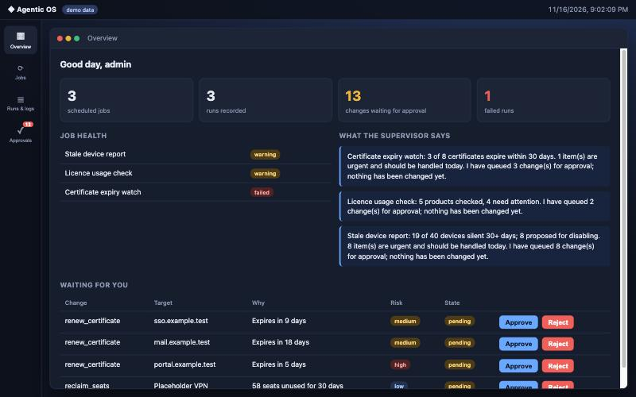
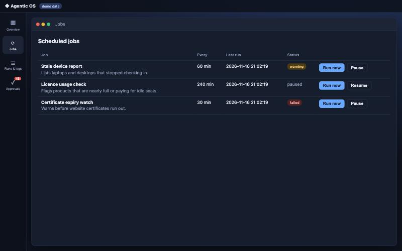
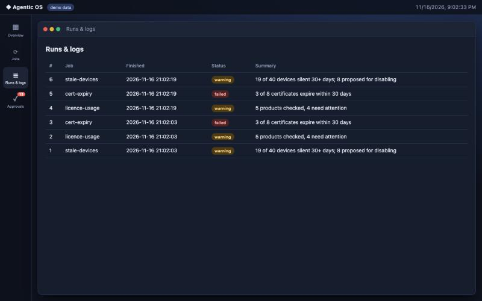
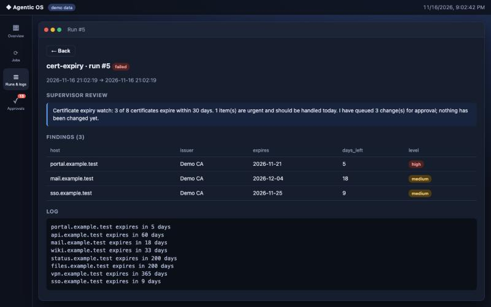
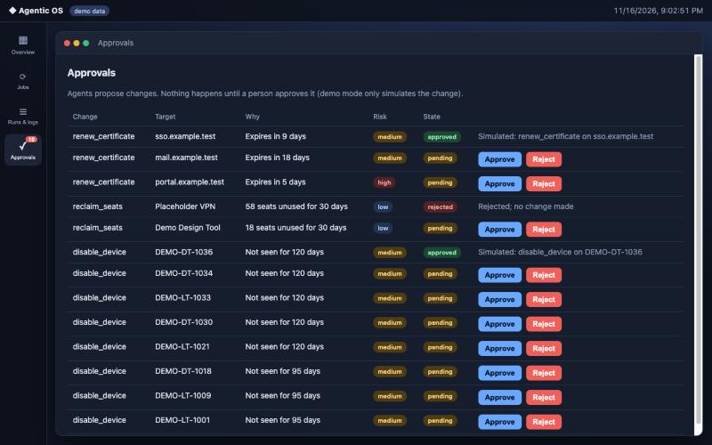
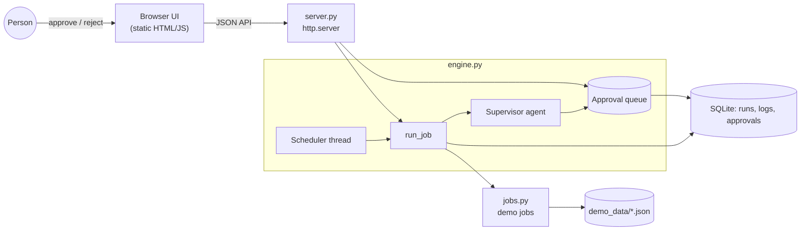

# Agentic OS

A small, local, desktop-style app where an AI **supervisor agent** watches recurring IT jobs:
it runs them on a schedule, keeps every run and its log, writes a plain-English review of what
it found, and **queues any change for a human to approve** before anything is touched.



> Everything here runs on **made-up demo data** (`example.com` / `example.test` names, fake
> devices and licences). No credentials, no network calls, nothing is ever really changed.

## Quick start

Needs Python 3.10+ and nothing else (standard library only).

```bash
git clone https://github.com/chamu262/agentic-os-demo.git && cd agentic-os-demo
python -m agentic_os
```

Open http://127.0.0.1:8765. Options: `--port 9000`, `--db runs.db` (keep history in a SQLite
file instead of memory).

Run the tests:

```bash
python -m unittest discover -s tests -v
```

## What it does

| Demo job | Every | What it looks for | Change it may propose |
|---|---|---|---|
| Stale device report | 60 min | Laptops/desktops that haven't checked in for 30+ days | Disable devices silent 90+ days |
| Licence usage check | 240 min | Products nearly out of seats, or paying for idle seats | Reclaim unused seats |
| Certificate expiry watch | 30 min | Website certificates (TLS, the padlock in the browser) expiring within 30 days | Renew the certificate |

The flow for every run:

1. **Scheduler** notices a job is due (or you press *Run now*).
2. **Job** reads its data and returns *findings* plus *proposed actions*. Jobs never change anything.
3. **Supervisor agent** reviews the result, writes a short summary and puts each proposed action
   in the approval queue (skipping duplicates already waiting).
4. **A person** approves or rejects it. In demo mode an approval is only *simulated* and recorded.

## Screenshots

| Jobs: schedule, run now, pause | Runs & logs |
|---|---|
|  |  |
| **One run: review, findings, log** | **Approvals queue** |
|  |  |

## Architecture



```
agentic_os/
  jobs.py        demo jobs: read data, return findings + proposed actions
  engine.py      SQLite storage, Supervisor agent, scheduler
  server.py      JSON API + serves the UI (standard library only)
  static/        the desktop-style UI
  demo_data/     made-up devices, licences, certificates
tests/           unit + HTTP tests (unittest)
```

### API

| Method | Path | Purpose |
|---|---|---|
| GET | `/api/jobs`, `/api/runs[?job=id]`, `/api/runs/{id}`, `/api/approvals`, `/api/stats` | Read state |
| POST | `/api/jobs/{id}/run` · `/enable` · `/disable` | Run or pause a job |
| POST | `/api/approvals/{id}/approve` · `/reject` | Decide a proposed change |

### Adding a job

Write a function `(today, data_dir) -> JobResult` in `jobs.py` and add it to `JOBS`.
Return `ProposedAction`s for anything that should change; the approval gate comes for free.

### Using a real language model

`Supervisor.review` is rule-based so the demo works offline. Replace it with a call to the
model of your choice to get richer write-ups; keep the rule that actions only ever go to the
approval queue.

## Design choices

- **Human in the loop by default.** Agents propose; people approve. Every decision records who and when.
- **No dependencies.** Python standard library only, so it starts with one command anywhere.
- **Failures are data.** A job that crashes is recorded as a failed run instead of stopping the app.

## License

MIT, see [LICENSE](LICENSE).
