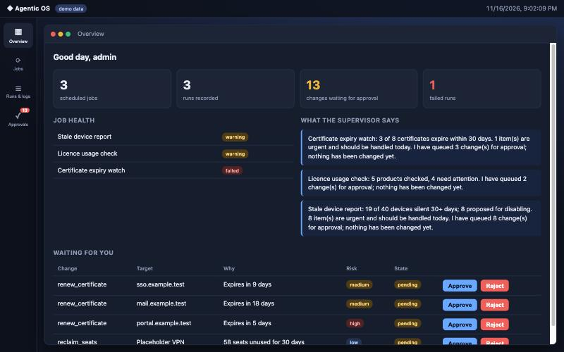
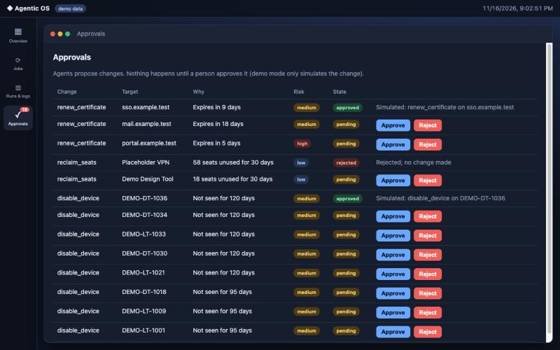

# `agentic_os/` — the app

This is the Python package. Everything the app needs lives here, and it uses only Python's
standard library (nothing to install). Start it from the repo root with `python -m agentic_os`.

| File / folder | What it does |
|---|---|
| `__init__.py` | Marks this as a package and holds the version number. |
| `__main__.py` | Lets `python -m agentic_os` start the app (it just calls `server.main`). |
| `jobs.py` | The demo jobs. Each reads made-up data and returns *findings* (what it saw) and *proposed actions* (changes it would like made). Jobs never change anything themselves. |
| `engine.py` | The core: stores runs, logs and approvals in SQLite (a small file-based database); the **Supervisor** agent that reviews each run and queues changes for approval; and the **scheduler** that runs jobs when they are due. |
| `server.py` | A small web server: a JSON API for the UI, and it serves the files in `static/`. |
| `static/` | The desktop-style web interface. See [static/README.md](static/README.md). |
| `demo_data/` | Made-up devices, licences and certificates the jobs read. See [demo_data/README.md](demo_data/README.md). |

How a run flows: scheduler → job → supervisor review → approval queue → a person approves or rejects.

