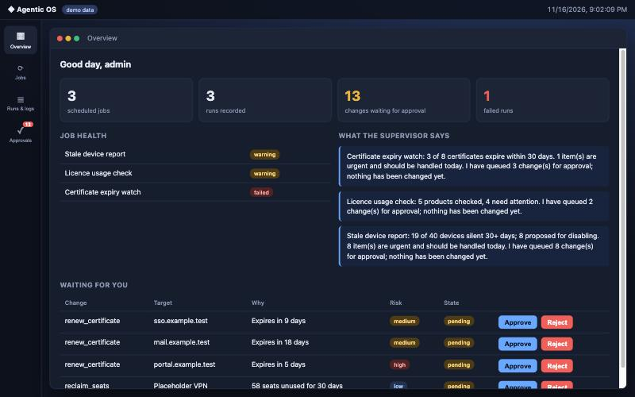
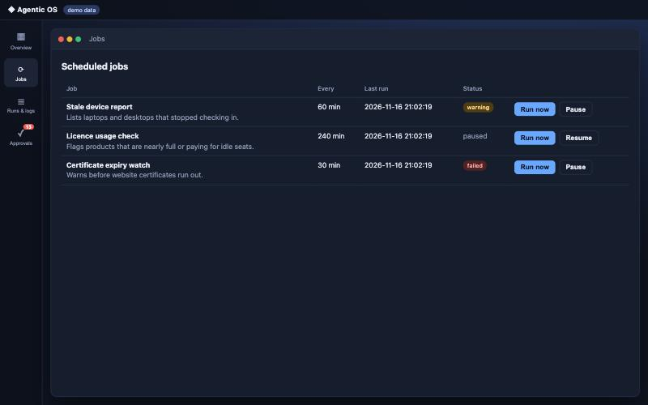
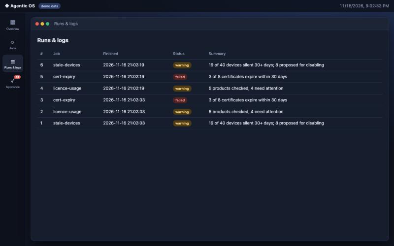
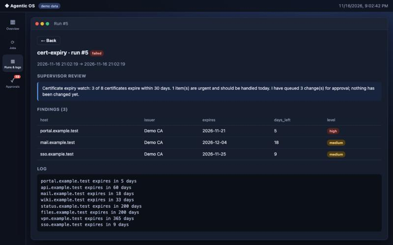
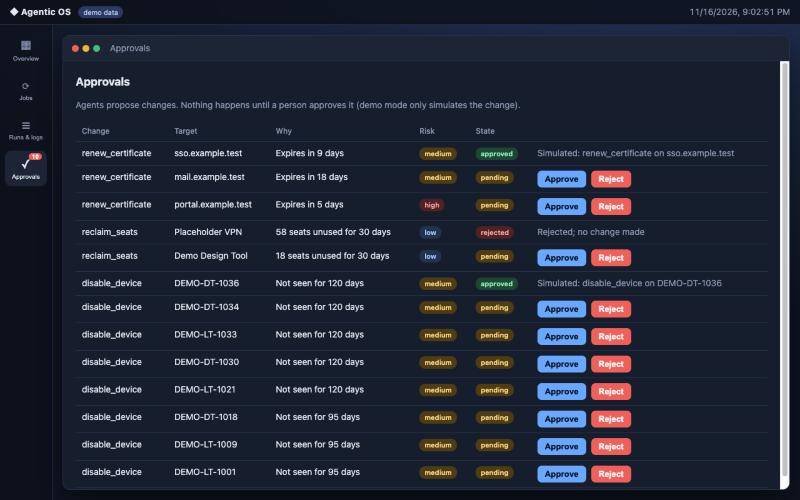

# `static/` — the user interface

The screens you see in the browser. Plain HTML, CSS and JavaScript with no build step; the
server in `../server.py` sends these files and the page talks to it through the JSON API (`/api/...`).

| File | What it does |
|---|---|
| `index.html` | The page frame: top bar, the dock of app icons on the left, and one window. |
| `app.css` | The look: dark desktop theme, cards, tables and coloured status labels. |
| `app.js` | Loads data from the API and draws the four views; handles *Run now*, *Pause* and *Approve / Reject*. |

The four views:

| View | Screenshot |
|---|---|
| **Overview** — counts, job health, the supervisor's latest reviews, changes waiting |  |
| **Jobs** — schedule, last result, run now, pause/resume |  |
| **Runs & logs** — every run; click one for its review, findings and log |   |
| **Approvals** — proposed changes to approve or reject |  |
